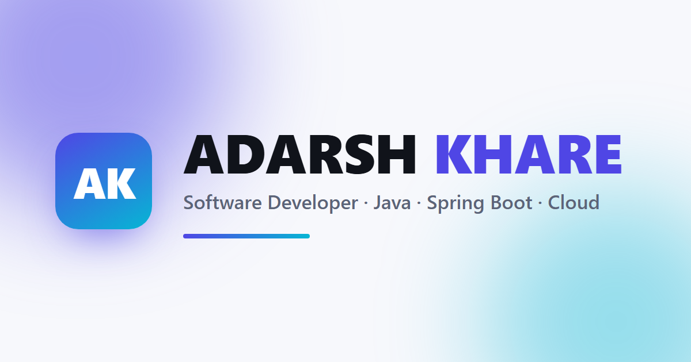

# Adarsh Khare - Portfolio

A personal portfolio website built with **Spring Boot** and published as a fast,
free **static site on GitHub Pages**.

**Live:** https://adarshkhare2.github.io/adarshkhare/



---

## Overview

This project has two parts that share one source of content:

1. **A Spring Boot web application** - a Thymeleaf front end backed by Spring Data JPA
   (H2), with a secure admin panel for editing content and a contact form that stores
   messages.
2. **A static export** of the rendered page in `site/` - what visitors actually see,
   hosted for free on GitHub Pages with no server.

The author edits content through the local admin panel, exports the rendered page into
`site/`, and pushes; a GitHub Actions workflow publishes `site/` automatically.

## Features

- Responsive single-page portfolio: hero, about, skills, experience, projects,
  certifications, education, and contact.
- Password-protected admin panel to add, edit, and delete all content.
- File uploads: profile photo, resume, project images, certificate PDFs, and a custom
  background image.
- Automatic certificate thumbnails generated from PDFs with Apache PDFBox.
- Auto-calculated "years of experience" so the number never goes stale.
- Backend-free live visitor counter that works on the static site.
- SEO: `robots.txt`, `sitemap.xml`, and Open Graph / Twitter metadata.
- Security: Spring Security form login (BCrypt), CSRF protection, and a strict
  Content-Security-Policy.

## Tech stack

| Area       | Technology                                              |
|------------|---------------------------------------------------------|
| Language   | Java 17                                                 |
| Framework  | Spring Boot 3.3.5                                       |
| View       | Thymeleaf                                               |
| Persistence| Spring Data JPA / Hibernate + H2                        |
| Security   | Spring Security                                         |
| PDF        | Apache PDFBox 3.0.3                                     |
| Build      | Maven                                                   |
| Front end  | Hand-written HTML, CSS, vanilla JavaScript              |
| Hosting    | GitHub Pages (static) via GitHub Actions                |

## Project structure

```
portfolio/
|- src/            Spring Boot application (Java, templates, static assets)
|- site/           The deployed static website (GitHub Pages)
|- data/           H2 database files (content)
|- uploads/        Uploaded files (certificates, images, resume, photo)
|- docs/           Build guide and file/folder reference
|- Dockerfile      Optional container build for the app
|- railway.json    Optional Railway deploy config
```

See [docs/PROJECT_STRUCTURE.md](docs/PROJECT_STRUCTURE.md) for a full breakdown of
every file and folder.

## Getting started

### Prerequisites

- JDK 17 or newer
- Maven 3.6+

### Build

```bash
mvn clean package
```

This produces `target/portfolio-1.0.0.jar`.

### Run

```bash
java -jar target/portfolio-1.0.0.jar
```

Then open http://localhost:8080.

Admin panel: http://localhost:8080/login - default credentials `admin` / `changeme`.
Change them with the environment variables below.

## Configuration

| Variable                   | Default     | Purpose                       |
|----------------------------|-------------|-------------------------------|
| `PORT`                     | `8080`      | HTTP port                     |
| `PORTFOLIO_ADMIN_USERNAME` | `admin`     | Admin login username          |
| `PORTFOLIO_ADMIN_PASSWORD` | `changeme`  | Admin login password          |
| `PORTFOLIO_UPLOAD_DIR`     | `./uploads` | Upload storage directory      |

## Deployment

- **Static site (public):** every push to `main` triggers
  `.github/workflows/deploy-pages.yml`, which publishes the `site/` folder to GitHub
  Pages. No secrets required.
- **Java app (optional):** build the included `Dockerfile` and run the container; a
  `railway.json` example is provided.

## Documentation

- [docs/BUILD.md](docs/BUILD.md) - build, run, export, and deploy guide.
- [docs/PROJECT_STRUCTURE.md](docs/PROJECT_STRUCTURE.md) - what every file and folder does.

## License

Released under the [MIT License](LICENSE).

## Contact

- Email: adarshkhare25032000@gmail.com
- LinkedIn: https://www.linkedin.com/in/adarsh-khare-1822651ba
